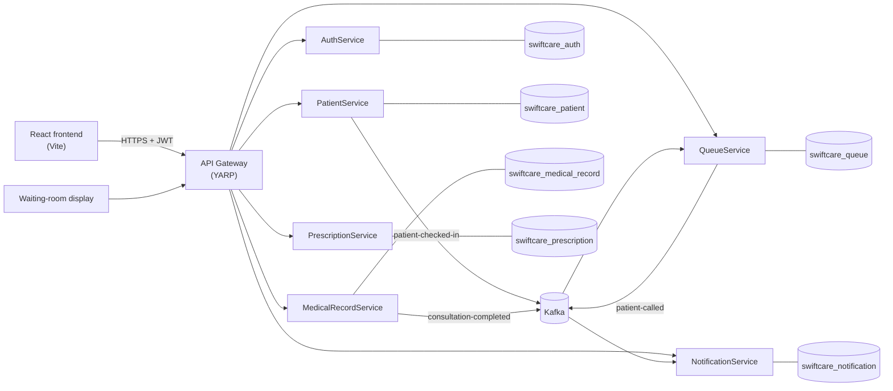

# SwiftCare

**Smart Care, Better Life.**

[](https://github.com/swiftcare-org/swiftcare/actions/workflows/ci.yml)
[](https://sonarcloud.io/summary/new_code?id=swiftcare-org_swiftcare&branch=develop)

SwiftCare is an outpatient clinic management system. It takes a patient from the reception desk, through the waiting room and the doctor's consultation, to the prescription counter, and gives administrators a live view of the department and its daily and monthly figures.

It is built as six independently deployable ASP.NET Core microservices behind a YARP API Gateway, with a React frontend, MySQL for storage and Kafka for events between services. It runs locally with Docker Compose and in production on Microsoft Azure.

- **Production:** [swiftcare.me](https://swiftcare.me) (available during scheduled demo windows)
- **Project video:** [SwiftCare summary on YouTube](https://youtu.be/85lzhulTAbY)

## Contents

- [Features](#features)
- [Architecture](#architecture)
- [Technology stack](#technology-stack)
- [Repository structure](#repository-structure)
- [Getting started](#getting-started)
- [Testing](#testing)
- [CI/CD and environments](#cicd-and-environments)
- [Security and privacy](#security-and-privacy)
- [Observability](#observability)
- [Documentation](#documentation)
- [Contributing](#contributing)
- [Team](#team)
- [License](#license)

## Features

**Receptionist**
- Register new patients and check in returning patients, with a queue number assigned automatically
- Manage today's queue, see who is waiting, in consultation or completed
- Record allergies and chronic conditions, and update patient details
- Dispense prescriptions at the counter
- Follow a live activity feed of check-ins, calls and completed consultations

**Doctor**
- Call the next patient from a shared waiting pool, with the assignment shown on the waiting-room display
- See red allergy, amber chronic-condition and blue overdue follow-up alerts before consulting
- Record consultations and vital signs, using personal consultation templates
- Review the patient's consultation, vital-sign and prescription history
- Write prescriptions, or record that a consultation needs none
- Set a follow-up date and instructions

**Administrator**
- Create, edit, deactivate and reactivate staff accounts, and reset passwords
- Review an audit log of sign-ins and account changes
- Generate daily and monthly summary reports: patients seen, new and returning patients, patients per room, top diagnoses, prescriptions and a weekly breakdown

**Public**
- A waiting-room display showing which queue number is called to which room, with no personal information

## Architecture



The **API Gateway** is the only entry point. It validates the JWT, checks the session with AuthService, applies role-based policies per route, strips any identity headers sent by the client and attaches trusted ones, and checks that consultation and prescription writes belong to the doctor's own visit before forwarding them. Services reject any request that did not come through the gateway.

Each service owns its own MySQL database and never reads another service's data. Services that need to react to each other do so through Kafka events, which carry identifiers rather than personal details.

### Services

| Service | Port | Database | Responsibility |
| --- | ---: | --- | --- |
| [API Gateway](ApiGateway/README.md) | 8000 | | Routing, JWT validation, session checks, role policies, trusted identity headers |
| [AuthService](services/AuthService/README.md) | 5000 | `swiftcare_auth` | Staff accounts, sign-in and sign-out, JWT issuance, audit log |
| [PrescriptionService](services/PrescriptionService/README.md) | 5001 | `swiftcare_prescription` | Prescriptions, no-prescription decisions, dispensing, prescription reports |
| [PatientService](services/PatientService/README.md) | 5002 | `swiftcare_patient` | Registration, search, profiles, allergies, chronic conditions, check-in |
| [QueueService](services/QueueService/README.md) | 5003 | `swiftcare_queue` | Daily queue numbers, calling patients, waiting-room display |
| [MedicalRecordService](services/MedicalRecordService/README.md) | 5004 | `swiftcare_medical_record` | Consultations, vital signs, templates, follow-ups, patient history |
| [NotificationService](services/NotificationService/README.md) | 5005 | `swiftcare_notification` | Activity feed, daily and monthly reports |

### Events

| Topic | Published by | Consumed by | Meaning |
| --- | --- | --- | --- |
| `patient-checked-in` | PatientService | QueueService, NotificationService | A patient registered or checked in; QueueService creates the queue entry |
| `patient-called` | QueueService | NotificationService | A doctor called a patient to a room |
| `consultation-completed` | MedicalRecordService | QueueService, NotificationService | A consultation finished; QueueService completes the queue entry |

Every consumer is idempotent: a redelivered event is recognised by its event ID and processed once.

## Technology stack

| Area | Technology |
| --- | --- |
| Frontend | React 19, TypeScript, Vite 8, Tailwind CSS 4, React Router 7 |
| Backend | ASP.NET Core on .NET 10, YARP reverse proxy, JWT bearer authentication |
| Data | MySQL 8.4, Entity Framework Core 9 (Pomelo provider) |
| Messaging | Apache Kafka (Confluent 7.6.1) with ZooKeeper |
| Testing | xUnit, Moq, Selenium WebDriver, Stryker.NET, Apache JMeter |
| Quality and security | SonarQube Cloud, CodeQL, Trivy, gitleaks, dependency audits |
| Delivery | Docker, Docker Compose, GitHub Actions, Terraform, Azure Container Apps, Azure Static Web Apps |
| Observability | Azure Application Insights through OpenTelemetry, structured logs, correlation IDs |

EF Core is pinned to 9 rather than 10 because the Pomelo MySQL provider does not yet support EF Core 10. Keep the .NET SDK and EF Core versions the same in every service.

## Repository structure

```text
swiftcare/
├── .github/workflows/      CI (ci.yml) and CD (cd.yml)
├── ApiGateway/             YARP gateway
├── services/               The six backend services, one folder each
├── frontend/               React application
├── tests/
│   ├── <Service>.UnitTests/    Unit tests per service and for the gateway
│   ├── E2ETests/               Selenium end-to-end tests
│   ├── MutationTesting/        Stryker.NET configuration and runner
│   └── PerformanceTest/        JMeter load and stress tests (local and Azure)
├── deployment/
│   ├── cd/                 Release manifest, deployment and smoke-test scripts
│   ├── docker/             MySQL initialisation for Compose
│   └── terraform/          Azure infrastructure for development and production
├── docs/                   CI/CD reference and sprint stand-up logs
├── docker-compose.yml      Local stack
└── SwiftCare.slnx          Solution with every service and test project
```

## Getting started

### Prerequisites

- Git
- Docker Desktop with Docker Compose
- .NET SDK 10.0
- Node.js 22 and npm

### 1. Configure

```bash
git clone https://github.com/swiftcare-org/swiftcare.git
cd swiftcare
cp .env.example .env
cp frontend/.env.example frontend/.env
```

Edit `.env` and replace every placeholder, in particular `MYSQL_PASSWORD`, `JWT_SIGNING_KEY`, `GATEWAY_INTERNAL_SECRET` and `AUTH_SEED_PASSWORD`. `frontend/.env` only needs `VITE_GATEWAY_URL=http://localhost:8000`. Never commit either file.

### 2. Start the stack

```bash
docker compose up -d --build
docker compose ps
```

This starts MySQL, ZooKeeper, Kafka (with its topics), Kafka UI, the six services and the gateway. On a first start Kafka can take longer than the services are willing to wait; if a service reports Kafka as unhealthy, run `docker compose up -d` again.

On an empty MySQL volume, `deployment/docker/mysql-init/01-create-databases.sh` creates the six databases automatically.

### 3. Apply database migrations

Migrations never run at startup. Apply them once on a new database, and again after pulling a change that adds one:

```bash
docker compose run --rm authservice --migrate
docker compose run --rm patientservice --migrate
docker compose run --rm queueservice --migrate
docker compose run --rm medicalrecordservice --migrate
docker compose run --rm prescriptionservice --migrate
docker compose run --rm notificationservice --migrate
```

### 4. Start the frontend

```bash
cd frontend
npm ci
npm run dev
```

Open <http://localhost:5173>.

### 5. Sign in

In Development, AuthService seeds four synthetic accounts on first start, all using the password set in `AUTH_SEED_PASSWORD`:

| Username | Role | Notes |
| --- | --- | --- |
| `dr.chen` | Doctor | Room `R-204` |
| `reception.silva` | Receptionist | |
| `admin.fernando` | Admin | |
| `dr.rao` | Doctor | Deactivated, to show the rejected sign-in |

If `AUTH_SEED_PASSWORD` is not set, seeding is skipped and every sign-in fails. The seed data is synthetic; never load real patient or staff data into a local stack.

### Useful local addresses

| What | Address |
| --- | --- |
| Frontend | <http://localhost:5173> |
| API Gateway health | <http://localhost:8000/health> |
| Waiting-room display | <http://localhost:5173/queue/display> |
| Kafka UI | <http://localhost:8080> |
| API docs (Scalar), one per service | `http://localhost:5000/scalar/v1` to `http://localhost:5005/scalar/v1` |

The API docs are only available in the Development environment. Requests sent from them directly to a service need the `X-Gateway-Secret` header and the identity headers the gateway normally adds.

### Stop

```bash
docker compose stop        # keeps your data
docker compose down        # removes containers, keeps data
docker compose down -v     # removes containers and deletes all local data
```

## Testing

| Suite | Command | Notes |
| --- | --- | --- |
| Unit tests | `dotnet test SwiftCare.slnx` | xUnit and Moq; one project per service and for the gateway. Needs no database or Kafka. |
| Frontend | `cd frontend && npm run lint && npm run build` | oxlint and the TypeScript build |
| End-to-end | See [tests/E2ETests](tests/E2ETests/README.md) | Selenium against a running stack; also runs in CI |
| Mutation | `cd tests/MutationTesting && ./run-mutation-tests.ps1` | Stryker.NET per service; see [tests/MutationTesting](tests/MutationTesting/README.md) |
| Performance | See [tests/PerformanceTest/azure](tests/PerformanceTest/azure/README.md) | JMeter load and stress plans, locally and against Azure |

Pull requests must pass every unit test, keep line coverage at or above the CI minimum, pass the SonarQube Cloud quality gate on new code, and keep each changed service at or above its mutation-score threshold.

## CI/CD and environments

**CI** runs on every push and pull request to `develop` and `main`: formatting, build and unit tests with coverage, frontend lint and build, end-to-end tests, mutation testing, SonarQube Cloud, migration validation, Docker image builds, container and dependency vulnerability scans, secret scanning and CodeQL.

**CD** releases only the deployables that changed, each with its own image, migration job, smoke test and automatic rollback.

| | Development | Production |
| --- | --- | --- |
| Branch | `develop` | `main` |
| Frontend | `dev.swiftcare.me` | `swiftcare.me`, `www.swiftcare.me` |
| API | `api-dev.swiftcare.me` | `api.swiftcare.me` |
| Access | GitHub sign-in required | Public |
| Availability | Approved demo windows | Approved demo windows |

Both environments are started only during approved demo windows to control cost. The full reference, including the CI jobs, quality gates, CD release rules, smoke checks, rollback and required GitHub Environment values, is in [docs/ci-cd.md](docs/ci-cd.md). Infrastructure is described in [deployment/terraform](deployment/terraform/README.md).

## Security and privacy

- **One entry point.** Services have internal ingress only on Azure and reject any request without the gateway's shared secret.
- **Trusted identity.** The gateway removes client-supplied identity headers and sets them from the validated JWT. Every authenticated request is checked against AuthService, so signing out or deactivating an account takes effect immediately.
- **Role-based access.** Each gateway route has a policy for Doctor, Receptionist, Admin or anonymous access, and services check ownership on top of it.
- **Visit validation.** Consultation and prescription writes are accepted only for the doctor's own active or completed visit with matching patient and queue identifiers.
- **Minimal events.** Kafka events carry identifiers, not names or clinical notes. The only clinical field shared is the diagnosis, which the reports count.
- **Safe logging.** Logs never contain passwords, tokens, connection strings or patient details; client-supplied values are sanitised before logging.
- **Secrets.** Real values live only in local `.env` files and GitHub Environment secrets. Azure deployment authenticates through GitHub OIDC with no long-lived credentials.

## Observability

- Every service and the gateway expose `GET /health`.
- Requests carry an `X-Correlation-ID` that is logged by the gateway and every service.
- When `APPLICATIONINSIGHTS_CONNECTION_STRING` is set, each service sends traces and logs to Azure Application Insights through OpenTelemetry. Locally it is unset and telemetry is off.
- Terraform defines Application Insights availability tests and alerts for the production frontend and gateway; see [deployment/terraform](deployment/terraform/README.md).

## Documentation

| Topic | Location |
| --- | --- |
| Each service: endpoints, configuration, data model | `services/<Service>/README.md` |
| Gateway routes and policies | [ApiGateway/README.md](ApiGateway/README.md) |
| Frontend pages and behaviour | [frontend/README.md](frontend/README.md) |
| CI, quality gates and CD | [docs/ci-cd.md](docs/ci-cd.md) |
| Azure infrastructure and operations | [deployment/terraform/README.md](deployment/terraform/README.md) |
| End-to-end, mutation and performance testing | `tests/E2ETests`, `tests/MutationTesting`, `tests/PerformanceTest` |
| Sprint stand-up logs | [docs/Daily Standups Log](docs/Daily%20Standups%20Log) |

## Contributing

Branching, commit messages, pull requests and the definition of done are described in [CONTRIBUTING.md](CONTRIBUTING.md). In short: branch from `develop`, use Conventional Commits, and open a pull request into `develop` that passes CI and has an approving review.

## Team

SwiftCare was built by Group 22 over four sprints, with the Business Analyst, Developer, DevOps and QA roles rotating each sprint.

| Name | Student ID |
| --- | --- |
| Kularatne P.O.N | IT24103437 |
| Rajasinghe R.M.G | IT24103439 |
| Kularatne R.A.D | IT24103431 |
| De Silva J.W.D.J.O. | IT24103444 |

The product backlog closed with 34 of 34 user stories done.

## License

This is an academic project developed by Group 22 for the SE3022 Case Study Project. No open-source license has been granted; all rights are reserved by the authors.
